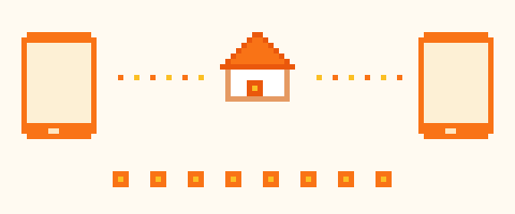
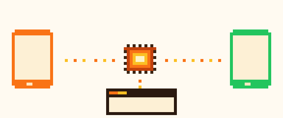
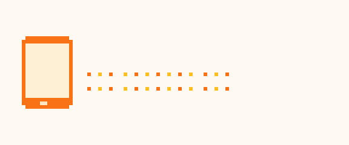

<p align="center"></p>

# Flare

**Your apps' backend, on Cloudflare.** Like Firebase, but it's your own
Worker: phones work offline, share data with each other, and catch up the
moment they're back online.

Sync, auth, feature flags, push notifications, product analytics and crash reporting, in one repo. Website: [flare.jkyf.dev](https://flare.jkyf.dev).

## What you get


**Offline first.** Every phone keeps a full local copy in SQLite and
writes instantly. Sync happens in the background.
<br clear="right">



**Shared spaces.** Phones join a space (a household, a team) with an
8‑letter invite code.
<br clear="right">


**Merges that make sense.** Two people edit at once and nothing gets lost:
newest edit wins per field, lists keep their order, sets and counters
merge. It's the approach Figma and Linear use for their data, not a text
CRDT like Yjs ([why](SYNC.md#why-not-yjs)).
<br clear="right">



**iOS, Android and the web.** One Rust core, with Swift and Kotlin on top.
Web pages read and write through your Worker.
<br clear="right">

**Feature flags.** List them in one `flags.json`; Cloudflare Flagship
serves them. Typed on every platform with no codegen step, and they work
offline.

**Analytics and crashes.** A Rust SDK queues events on disk and sends them
in batches to Iceberg tables you query with SQL. Crashes, hangs and errors
arrive the same way, with their stack and the last 30 events before them,
from MetricKit on iOS and the platform's own crash records on Android. No
Firebase, no Sentry, no extra SDK.



**Cheap to run.** One Durable Object per space, photos in R2. It sleeps
until someone syncs. Nothing to babysit.
<br clear="right">

## Add it

**Worker**

```sh
pnpm add "@sync/server@github:johnkueh/flare#0.5.0&path:/server"
pnpm add "@flare/auth@github:johnkueh/flare#0.5.0&path:/auth"   # accounts (AUTH.md)
pnpm add "@flare/flags@github:johnkueh/flare#0.5.0&path:/flags" # feature flags (FLAGS.md)
pnpm add "@flare/push@github:johnkueh/flare#0.6.0&path:/push"   # push notifications (PUSH.md), from 0.6.0
```

```ts
export { SpaceObject } from "@sync/server/space";
```

**iOS**: add the package `https://github.com/johnkueh/flare` and link
`SyncKit` and `SyncClient`.

**Android**

```kotlin
// settings.gradle.kts
maven("https://jitpack.io")
maven("https://pub-796846793f3e431ab3a92e0577c57dde.r2.dev/maven")

// app/build.gradle.kts
implementation("com.github.johnkueh:flare:0.5.0")
```

Then describe your data in one JSON file and open the store:

```swift
let store = try SyncStore.open(path: dbPath, schemaJson: schema)
try store.putDoc(collection: "groceries", doc: id, fieldsJson: #"{"name":"Milk"}"#)
```

## Learn more

- [SYNC.md](SYNC.md): setup in full, the data model, web pages, releasing
- [PROTOCOL.md](PROTOCOL.md): the wire format, for anyone writing a client
- [AUTH.md](AUTH.md): accounts on Better Auth, signing in from a phone
- [FLAGS.md](FLAGS.md): feature flags on Cloudflare Flagship, for iOS, Android, web, Node and Rust
- [PUSH.md](PUSH.md): push notifications to APNs and FCM from your Worker, and asking for permission gracefully
- [TELEMETRY.md](TELEMETRY.md): product analytics and crash reporting into Cloudflare Basin, from a Rust SDK
